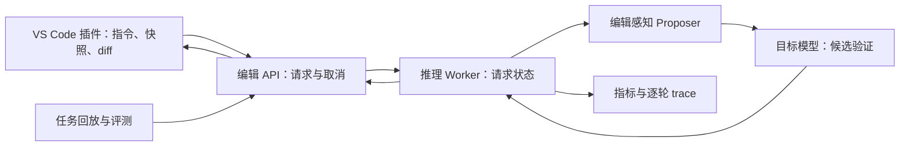

# PatchSprint 项目说明与 AI 协作上下文

版本：v0.1，设计基线。整理日期：2026-10-16（America/Los_Angeles）。

用途：这是一份可以整段交给 AI 的项目上下文，用于持续讨论、设计、学习、实现、评审和更新 PatchSprint。它同时包含已确定的用户目标、建议的工程方案、需要验证的研究假设，以及尚未确认的信息。它不是已经完成的实现说明或性能报告。

使用方法：将全文作为背景，并在末尾添加本轮具体任务。后续用户的明确修改优先于本版本中的设计建议。更新时保留已确认目标，记录重要决策变化，不把新建议自动写成已确认事实。

## 1. AI 应理解的用户背景与优先级

我是一个人开发这个项目。它起源于一门实践型 ML 课程的 final project，但最终质量必须足以作为 AI Infra 求职作品，在 GitHub 上公开，并在面试中演示和深入讨论。

我的方向是 AI Infra，重点是 LLM 推理服务和推理引擎，而不只是应用界面、API 调用或一般的 Agent 编排。我目前对 PyTorch、Transformer 实际推理路径和 CUDA 还不熟练，希望通过亲自实现和测量这个项目来学习掌握。

当前优先级如下：

1. 能解释并验证的技术深度、实现正确性和性能结论。
2. 真实、有用、容易演示的开发者产品体验。
3. 可复现、可维护、他人能理解的开源工程质量。
4. 通过项目建立 PyTorch、GPU 执行、性能分析与推理系统能力。
5. 满足课程的功能、创意、用途、报告与演示要求。

当前不要以截止日期或每周可投入时间为依据削弱最终技术目标。可以将复杂工作分阶段完成，但阶段性原型不等于最终作品。

可用资源是 NEU HPC。可能申请到 B200 等较强 GPU 和多卡，但型号、数量、显存、互联、访问权限、作业时限与排队情况尚未确认。不得把这些资源写成已经获得。核心正确性和算法设计应能在单卡、小模型上建立，资源增加后扩展实验。

对话中尚未提供 PatchSprint 已实现代码、GPU profiling 或性能测试结果。AI 不得把下文计划描述成已完成成果。

## 2. 项目名称、定位与一句话描述

项目名称：PatchSprint。

建议英文描述：An edit-aware speculative decoding backend with a lightweight VS Code editing extension.

中文定位：面向代码修改的编辑感知推测解码后端，加上轻量 VS Code 编辑插件。

一句话描述：开发者用自然语言提出单文件代码修改要求，PatchSprint 利用原代码中的可复用片段提出候选 token，通过目标模型验证，加快生成修改结果，并在 VS Code 中展示可接受或拒绝的 diff。

产品是开发者编辑工具；技术核心是生成、候选验证、KV 状态管理、GPU 执行与推理框架集成。

## 3. 真实场景与产品价值

典型任务是修改已有代码，而不是从零生成整个项目。例如：

- 为网络调用添加超时、错误处理和资源清理，保留现有接口。
- 修复一个边界条件，同时保留其他行为和已有代码风格。
- 给多个函数增加一致的参数校验。
- 修改配置或局部业务逻辑，同时保持未涉及部分。
- 将某段实现替换为新方案，并让已有测试继续通过。

代码修改的一个可利用特点是：输出常常保留输入代码中的大量内容。但保留比例、位置和 token 一致性随任务改变，必须测量，不能假设所有编辑都高度可复制。

用户价值包括缩短等待、减少复制粘贴、清晰审核差异，以及能够使用自托管推理后端。代码是否发送到远程机器由部署决定；使用学校 HPC 不等于代码留在本地，也不自动构成“私有部署已获批准”的结论。

## 4. 已确定的边界与首个完整版本

首个完整版本聚焦：

- Python 单文件编辑。
- 用户主动触发一次明确的修改请求。
- 输入是原文件快照和自然语言指令。
- 主生成任务先输出修改后的完整文件，插件据此计算并展示 diff。
- 使用预训练的代码指令模型作为目标模型。
- 先支持贪心解码，建立解码一致性与状态正确性。
- 支持取消、错误提示、文档版本校验、整体接受/拒绝及撤销。
- 支持真实实验指标、逐轮 trace 和可复现基线。

模型生成 diff 是必须认真评估的产品替代方案，但其 token 输出与完整文件生成不同，不能混为同一种解码任务比较。

自动行内补全、跨仓库检索、多文件 Agent、自动循环修复、随机采样、模型微调和分布式推理可作为后续扩展，不能遮蔽核心工作。是否扩展以研究价值和已有证据决定，不以“功能越多越有深度”为判断标准。

## 5. 模型大小如何随 HPC 资源调整

### 5.1 三种操作必须区分

**推理部署**：加载已有的 7B、14B 或更大 checkpoint，执行代码编辑。它是本项目主线。

**微调**：在已有 checkpoint 上更新全部或部分权重，例如 LoRA。只有模型编辑质量确实成为瓶颈，或形成独立且可验证的问题时，才考虑加入。

**从头预训练**：训练一个新的基础模型。本项目不以此为目标；拥有几张高端 GPU 也不应被直接解释为具备完整预训练的数据与算力条件。

从 7B 升级到 14B，通常是更换为已经训练好的 14B checkpoint，不需要先训练一个 14B 模型。7B checkpoint 也不能通过修改参数配置直接变成有效的 14B 模型。量化主要改变权重存储和计算方式，不把参数数量从 14B 变成 7B。

### 5.2 可更换 checkpoint 的模型层

可优先考察同一模型家族的不同规模，减少架构差异带来的变量。例如官方存在 [Qwen2.5-Coder-7B-Instruct](https://huggingface.co/Qwen/Qwen2.5-Coder-7B-Instruct)、[14B-Instruct](https://huggingface.co/Qwen/Qwen2.5-Coder-14B-Instruct) 和 [32B-Instruct](https://huggingface.co/Qwen/Qwen2.5-Coder-32B-Instruct)。它们是候选模型，不是永久锁定选择或“当前最佳模型”的断言。

模型层应配置化以下信息：

- model_id 与固定 revision。
- tokenizer 及其 revision、chat template、特殊 token、结束规则。
- 权重精度、KV 精度、量化方案及适配状态。
- 模型结构、层数、KV head 数、head dimension、位置编码设置。
- 输入、输出和上下文总预算。
- 推理 backend、单卡/张量并行、并发数。
- 支持的验证、回滚、缓存和候选长度能力。

同一家族也不能假设所有参数、分词与行为完全相同。切换模型后需要重建相关缓存，检查输出格式、位置与回滚语义，并重新验证解码和编辑质量。已有输入 KV 不得跨不同权重直接复用。

“可调整模型大小”在产品上体现为选择已验证的运行配置，例如 small/debug、7B、14B 或 32B，而不是任意拖动参数量。资源自动检测与配置推荐可以后续加入，但不得静默降级后仍声称使用原模型。一个请求从开始到结束锁定 checkpoint；发生 OOM 时，不得换另一模型接着拼接同一份输出，应明确失败或以新请求重新运行。

### 5.3 显存估算

仅权重的粗略估算是参数量乘以每参数字节数。以官方模型卡所列约 7.61B、14.7B、32.5B 参数和 2 bytes/parameter 的 BF16/FP16 为例：

| 模型标签 | 仅权重的理论容量，十进制 GB | 不包括的部分 |
| --- | ---: | --- |
| 7B | 约 15.2 GB | KV、激活、workspace、CUDA/runtime、框架缓存等 |
| 14B | 约 29.4 GB | 同上 |
| 32B | 约 65 GB | 同上 |

这些不是可运行所需显存承诺，也不是训练显存。量化还包含 scales、元数据及实现开销，不能只用位数相除给出精确占用。

全注意力模型中，KV 的简化量级可用下式辅助理解：

`KV bytes ≈ 2 × layers × sum(sequence_lengths) × kv_heads × head_dim × bytes_per_element`

这里的 2 表示 K 和 V，sum(sequence_lengths) 表示所有驻留序列的长度总和。真实分配还受 paging、共享、并行切分或复制、滑动窗口、验证临时状态等影响。使用模型实际配置和测量结果，不仅看参数量。

### 5.4 资源增长时扩展什么

| 资源情况 | 主要工作 |
| --- | --- |
| 较小 GPU 或资源紧张 | 更小目标模型、短输入、低并发，验证算法和状态 |
| 单卡能运行 7B | 建立正式基线、编辑质量、单请求延迟和 profiling |
| 单卡能运行 14B/32B | 研究方法随目标模型规模变化的收益与失败区间 |
| 多卡可用 | 并行独立实验、多副本服务；必要时研究张量并行 |

调整 checkpoint、长度、精度和并发，仍是同一个系统项目。若量化或 CPU offload 被用于满足资源限制，必须作为实验变量记录，不能与全精度 GPU 驻留方案混在一起归因。

更大的模型和更多 GPU 不自动增加技术深度。最重要的是解释性能变化来自模型、算法、内存、通信还是服务调度。

## 6. 产品流程与编辑一致性

标准流程：

1. 用户打开文件，执行 PatchSprint 编辑命令。
2. 输入修改指令；默认使用当前整个文件。
3. 插件保存源文本、文档版本、内容哈希和 request_id。
4. 后端检查输入长度，固定本次使用的模型配置，进入推理。
5. 插件显示进度；可提供简洁状态，不把底层指标强塞入日常流程。
6. 后端返回完整、未截断的修改结果与完成状态。
7. 插件用请求时的源快照与新结果打开原生 diff。
8. 用户接受或拒绝；应用前再次检查当前文件与请求快照一致。
9. 如文件已变化，保持结果可查看，但不直接覆盖新内容；重新请求或显式处理冲突。
10. 取消/失败/超时/达到长度上限，均不得把不完整结果当成功修改应用。

首版整体接受一次修改，保留正常撤销能力。逐 hunk 接受属于后续功能，需要单独处理状态与冲突。

编辑正确性优先于自动应用速度。代码检查或测试应有明确结果；通过检查不代表已证明符合全部用户意图。

## 7. 系统架构与模块职责



建议技术组合是 Python 后端、PyTorch/Transformers 参考路径、vLLM 正式集成候选、TypeScript VS Code 插件。具体依赖版本应在集成验证后固定。

模块职责：

- 插件：编辑交互、文档版本校验、diff、接受/拒绝、取消。
- API：输入校验、请求生命周期、配置选择、结果与指标封装。
- 模型适配器：模型加载、模板、forward、结束规则与能力检查。
- 推理 Worker：解码调度、request-local 状态、验证与缓存维护。
- Proposer：寻找复用位置、提出候选、接收接受反馈；不能决定最终 token。
- 验证器：执行目标模型判断、提交合法前缀与修正、维护一致状态。
- 指标系统：服务时间、GPU 执行、候选与接受情况、质量及失败。
- 评测：固定任务、基线、消融、复现和图表。

## 8. 核心算法：编辑感知推测解码

### 8.1 基本原理

普通自回归生成按顺序提交 token。推测解码先提出一段候选，再由目标模型在因果条件下验证多个位置。验证多个 token 不等于与生成一个 token 成本相同；收益取决于候选开销、接受数量、验证形状和运行环境。

基础参考是 [Fast Inference from Transformers via Speculative Decoding](https://arxiv.org/abs/2211.17192)。首版只实现贪心版本，随机采样的分布保持需要另外处理，不能直接套用贪心接受规则。

### 8.2 贪心验证的逻辑

设输入为 P，已确认输出为 Y，候选为 D=(d1,...,dK)。目标模型在位置 i 的预测基于 P、Y 以及候选中此前的 token。

- 只接受从 d1 开始连续等于目标模型贪心选择的前缀。
- 首个分歧位置出现后，提交该位置目标模型给出的修正 token。
- 后续候选位置的预测依赖了错误前缀，不得继续按本轮结果接受。
- 全部候选通过时，可以按正确实现处理额外的下一 token，但不得越过 EOS 或长度限制。
- 下一轮继续普通生成或重新提出候选。

概念过程如下。它不是可直接运行的代码；真实实现需要明确 logits 对齐、输入 token 与 cache 的物化时刻：

```text
初始化输入、模型状态和原代码候选索引
重复直到结束：
    根据已确认输出和本请求状态提出候选
    如果没有候选：执行普通贪心步骤
    否则：
        用目标模型验证候选
        找到连续接受前缀及首个分歧
        提交接受前缀和合法的修正/额外 token
        丢弃本轮不再有效的缓存状态
    更新输出、缓存位置、待输入 token 和匹配状态
    记录指标，并检查 EOS、长度与取消
```

### 8.3 原代码辅助不等于原代码 KV 直接搬用

原代码位于输入 prompt，修改后的代码位于输出；即使文本相同，位置与前文也不同。因此原代码提供候选 token，目标模型仍需验证它们在当前输出上下文中的选择。不得直接把输入原文的 KV 当作输出位置的 KV。

跨请求前缀缓存、原代码候选复用和输出 KV 增量维护是三件不同的事，需分别描述与归因。

## 9. 计划研究的 Proposer

核心假设：源代码范围、局部位置与近期接受反馈，能够改善候选选择或降低候选开销。假设尚未验证，不得描述成已证明优于通用方法。

### 9.1 Source-aware 候选来源

记录原代码在实际 prompt token 序列中的范围，优先从原文件取候选，减少从指令或其他内容错误取样。分词边界与源文本位置映射应显式检查，不能仅根据字符串长度推算 token 下标。

### 9.2 位置跟踪与重新对齐

- 保存本请求最近可信的源位置。
- 优先局部匹配，失败后扩大搜索。
- 对重复代码使用更长锚点、局部连续性和确定的消歧策略。
- 新增逻辑后，通过实际已提交输出重新寻找对齐位置。
- 删除、移动、重排时允许离开单调指针假设。
- 无可靠匹配时退回普通生成或通用匹配。

不得读取标准答案、测试预期 diff 或未来输出，作为在线候选定位依据。离线知道的真实修改比例只能用于分组分析，不能伪装成线上可用特征。

### 9.3 候选长度控制

建立固定长度基线后，再利用最近接受长度、拒绝频率、锚点强度和实测成本调整 K。可先做规则控制，再决定是否需要更复杂模型。

目标是提高有效提交速率，而非只追求接受率：

`有效速率(K) ≈ E[每轮实际提交 token] / (候选耗时 + 验证耗时 + 状态更新耗时)`

这个表达式用于组织实验，不是通用的精确性能定律。需要分析低接受区间、长候选开销、短输出与高并发等条件。

### 9.4 状态隔离与生命周期

位置、索引、候选长度控制器和统计量按 request_id 组织，不能绑定到不稳定的 batch 行号。请求结束或取消后回收；模型切换时检查并清理不兼容状态。

## 10. 正确性要求与测试重点

区分两个问题：

1. 解码正确性：优化路径是否正确实现目标解码行为。
2. 编辑质量：目标模型的输出是否完成用户要求。

模型可以正确执行解码却改错程序；测试通过也不能证明解码实现与基线一致。

首版使用固定权重、tokenizer、模板、精度、贪心参数和结束规则。参考实现与普通路径比较 token 级输出，定位首个分歧。矩阵形状和 kernel 路径变化可能引入浮点差异；若无法满足一致性要求，需明确报告原因、范围与限制，不得把随机种子固定当作数值一致性的证明。

状态需要明确区分：已确认输出长度、已物化 cache 长度、待输入 token、position_ids/cache_position 和本轮临时候选。不能在未明确约定的情况下假设这些长度总是相等。

重点测试：无候选、首个 token 拒绝、部分接受、全部接受、EOS 位于候选中、长度上限、重匹配失败、重复代码、文档修改冲突、取消后重试、批次位置变化，以及切换 checkpoint 后的重新初始化。

缓存裁剪语义与模型结构相关。Transformers 文档描述了 crop 及部分滑动窗口/线性注意力的限制，实际采用版本必须核验。[Transformers 缓存文档](https://huggingface.co/docs/transformers/main/kv_cache)

## 11. 参考实现与正式后端集成

先使用 PyTorch/Transformers 的权重加载和 forward 能力，自己编写普通生成、候选验证、状态更新和 trace。无需一开始重写所有 Transformer 层，也无需训练基础模型。

参考路径的目的：理解、验证、排错和小规模算法比较。它不应成为刻意低效的唯一性能基线。

正式集成优先评估固定版本 vLLM。2026-10-16 查阅的官方文档提供实验性 custom_class proposer，但请求元数据、动态候选数量、各模型与其他功能的兼容性需要先做最小验证，不能视为稳定即插即用接口。[vLLM 推测解码文档](https://docs.vllm.ai/en/latest/features/speculative_decoding/)

先验证一个完整请求能否传入源代码范围并维护状态，再扩大集成。若 hook 不够，明确所需最小 patch、维护成本与测试，而不是同时重写整个框架。

不长期维护两套同等规模的服务。参考路径作为正确性工具；正式路径承担产品与主要后端性能结论。

## 12. GPU 与 CUDA 技术深度

项目应包含真实 GPU profiling，以及至少一个与主路径相关的底层优化案例。优化可能不成功，但必须有正确性检查、真实测量和合理分析；不能预先承诺超过现有实现。

学习和实现顺序：

1. 张量 shape、stride、dtype、device、索引和内存布局。
2. 推理模式、矩阵运算、因果 mask、KV 读写与位置。
3. CUDA 异步执行、stream、event 和同步边界。
4. 使用 profiling 找到候选搜索、传输、验证或状态处理的瓶颈。
5. 针对热点比较更好的 PyTorch 实现、Triton 或 CUDA C++ 实现。

可研究的热点包括候选 gather/组装、连续匹配与首个拒绝位置统计、减少 host/device 传输、预分配、减少小 kernel 启动、适用时的形状分桶或 CUDA Graph。不能预设 GPU 搜索一定比 CPU 搜索快，也不能把教学 kernel 的微基准收益直接当成产品收益。

要区分局部加速和整体加速。例如占总时间 5% 的部分加速两倍，整体仅约提升 2.6%。已有框架可能已融合类似操作，必须查代码与 profile 后决定改什么。

CUDA 调用通常异步返回，计时要区分 CPU 提交、GPU 执行和端到端时间，避免每个 token 强制同步而扭曲性能。[CUDA 异步执行与 Events](https://docs.nvidia.com/cuda/cuda-programming-guide/02-basics/asynchronous-execution.html)

可用 [Triton 官方教程](https://triton-lang.org/main/getting-started/tutorials/) 学习分块、访存与 reduction，再选择相关热点深入 CUDA C++。学习练习与正式性能贡献应明确区分。

## 13. 推理服务要求

请求至少包含 request_id、文档版本、源哈希、语言、原代码、指令和服务端认可的配置标识。结果包含完成状态、修改代码、停止原因、模型与版本、策略与指标。

生命周期可表示为 received → queued → running → completed / cancelled / failed / timed_out。各终态应处理幂等回收，避免迟到结果重新修改状态。

取消需要从插件传递到 API 和引擎。前端隐藏结果不等于停止 GPU 工作。不能承诺任意 GPU kernel 立即被打断。

取消后停止继续调度、释放请求引用，与物理显存归还系统不同。可复用前缀和框架内存池可能仍保留，因此不能只看 nvidia-smi 判断回收是否正确。

单请求路径稳定后，再测试少量并发、队列等待、取消和有延迟约束的有效完成率。SLO 的数值由应用需求和测量确定，不预先套用“代码补全必须 200ms”的目标；PatchSprint 是主动触发的代码编辑任务。

## 14. 模型与运行配置示意

以下是设计示意，不代表这些字段已由某个后端原生支持。实现时映射到真实接口，固定软件版本并验证资源：

```yaml
model:
  model_id: Qwen/Qwen2.5-Coder-7B-Instruct
  revision: null  # 正式实验前固定
  dtype: bfloat16
  kv_cache_dtype: auto
  quantization: null
  max_context_tokens: 16384

runtime:
  backend: reference
  tensor_parallel_size: 1
  max_concurrent_requests: 1
  max_input_tokens: 8192
  max_new_tokens: 4096

decoding:
  mode: greedy
  method: edit_aware
  proposer_max_tokens: 32
  adaptive_proposal: false

editing:
  language: python
  output_format: full_file
  require_document_version_match: true

observability:
  request_metrics: true
  detailed_trace: false
```

这里的长度与候选数只是初始示例，不是调优结果。输入长度、输出预算、验证临时长度和模型上下文限制必须一致检查；输出截断属于失败状态，不是可应用的完整结果。

7B 切换 14B 时改变 checkpoint 并重新检查资源与能力，保留插件/API 协议。不要把任何层数、hidden size、词表大小或 cache 布局硬编码成适用于所有模型。

## 15. 基线、消融与公平比较

至少规划以下方法：

| 方法 | 作用 |
| --- | --- |
| 普通自回归完整文件生成 | 目标解码基线 |
| 后端现成 prompt lookup | 检验是否超出现有能力 |
| 后端支持时的 suffix 等强基线 | 避免只与弱方法比较 |
| 自己的 source-aware 固定长度 proposer | 分离来源与定位贡献 |
| 加位置跟踪或重新对齐策略 | 测试编辑结构信息的作用 |
| 加自适应候选长度 | 测试长度控制收益 |
| 生成 diff 再应用 | 真实产品替代方案 |

与普通解码比较时，固定模型、权重版本、精度、tokenizer、输入模板、停止条件、最大长度、硬件和资源预算。缓存冷热策略一致，明确预热、编译和冷启动。

参考路径内部与正式后端内部的加速分别报告。跨后端比较可以做，但不得全部归因于自定义 proposer。7B→14B 的质量变化不属于解码优化收益。

diff 与完整文件输出分别测质量和应用开销，不能以输出 token/s 直接给两种产品方案排名。diff 解析或应用失败也要统计，不允许静默修补后按一次成功计算。

做 source-aware、位置跟踪、自适应长度、GPU 优化各项消融。参数在开发集确定；不能逐任务用真实答案挑最优 K 再作为线上结果。

## 16. 数据与任务设计

先建立小型可人工检查任务集，覆盖模型能力与算法边界，再扩大保留测试集和外部验证。起步任务数量用于可行性，不是最终统计充分性的承诺。

任务类别包括局部修改、分散修改、新逻辑、删除/移动、重复结构、大范围重写、长输入和短输出。不能只选择原文保留极高的任务。

每条任务保存：任务 ID、来源与许可、原代码、修改指令、行为要求、原有测试、新测试或人工检查规则、语言和任务分组。示范任务、调参任务与正式评估分离。

按原文件/仓库/任务来源分割，避免同一文件的轻微变体同时出现在开发集与测试集。公开基准需核实原始来源与许可，不能把第三方题目、测试或分析称为自己的原创。

修改密度和可复制比例可用于事后分组；代码的标准修改不唯一，功能测试不能只检查文本等于某个参考答案。

测试应同时检查新增要求与原有行为。记录语法错误、测试失败、未完成指令、无关改动和输出格式失败。AI 评分可辅助，不能成为唯一质量证据。

## 17. 指标与统计方法

主要指标：

- 端到端可用编辑延迟：发起操作到完整有效结果可供查看，说明是否包含校验/测试。
- 服务延迟拆分：网络、排队、tokenization/prompt 准备、prefill、decode、格式处理、diff 和可选检查。
- decode 内部：候选生成、目标验证、普通步骤、cache/状态更新。
- 提出候选总数、接受总数、接受率、每轮有效提交数和目标 forward 次数。
- 输出完整性、贪心 token 一致率与首处分歧、编辑测试通过率及失败率。
- 峰值显存、必要时的驻留量和 GPU 时间。
- 并发条件下的 P50/P95、吞吐、超时/拒绝/取消及取消后无效工作。

接受率以总接受数/总候选数为主要汇总，不只平均各请求百分比。普通提交与候选接受分开计数。

GPU 段用正确的设备计时；端到端用完整服务测量。详细 trace 和 profiler 有开销，应与正式性能跑分区分。预热之后重复测量，交替或随机化方法顺序，报告样本量、分布或不确定性。

不同长度任务报告分组结果，说明聚合权重。不得仅删除失败或超时样本后计算“平均加速”；报告全任务结果，以及成功公共子集的配对分析。输出一致的解码方法可以直接配对；不同输出格式按最终任务完成情况比较。

## 18. HPC 部署与多卡扩展

在申请到的计算节点中运行模型与 API，开发者电脑运行插件。连接按学校支持方式验证，不假设计算节点能被公网直接访问。

记录 GPU 型号、数量、可用显存、互联、CPU/RAM、驱动、CUDA、PyTorch、推理框架、容器、SLURM 参数与模型 revision。NEU 的 GPU 权限、B200、时长和 profiling 权限均以实际账户为准。

作业排队、容器准备、模型加载、编译、预热、服务就绪后的请求分别计量。录屏前准备可用服务；保留可复现的录屏与原始实验结果。

多卡先用于独立实验并行，再根据问题选择多副本或张量并行。前者研究吞吐、排队、路由；后者研究切分与通信。不能假设 TP=N 自动带来 N 倍延迟改善，也不能忽略 KV 或权重在不同并行策略中的复制。

单 GPU 的两个比较任务若同时运行会互相干扰。展示可以使用明确标注的独立运行回放；性能结论来自受控测量，不来自人为放慢的动画。

## 19. 技术深度的交付标准

高质量最终作品应形成以下证据链：

1. 可解释的普通解码：亲自控制 forward、token 选择、位置与 KV。
2. 正确的推测验证：处理接受、拒绝、EOS、长度和回滚，能追查分歧。
3. 自己的编辑感知 proposer：有明确策略、对照、消融与失败分析。
4. GPU profiling：有真实 trace，说明 CPU、GPU、传输和同步瓶颈。
5. 一个相关底层优化案例：有正确性与局部/整体性能比较，不要求虚构成功。
6. 成熟后端集成：在已有优化和真实请求状态之上检验收益。
7. 完整编辑产品：插件可用、版本冲突可处理、结果可审核。
8. 可复现评测：不同任务与模型规模的适用边界清楚。

仅开启框架现成 speculative decoding 参数不满足预期深度。另一方面，也不要求为了证明能力重写整个 Transformer、完整推理框架或从头训练基础模型。

## 20. 按里程碑推进，而不先设周数

| 阶段 | 主要产物 | 进入下一阶段的判断 |
| --- | --- | --- |
| 资源与模型可行性 | 资源实测、候选模型与小任务结果 | 模型能处理代表性任务，长度与显存满足需要 |
| 普通解码参考 | 自己控制的生成循环与状态 trace | cache、位置、结束规则可解释、可检查 |
| 推测正确性 | 固定候选提出与验证/回滚 | 边界测试与 token 对比可追查 |
| 编辑算法 | source-aware、定位与长度控制 | 消融能区分各项作用 |
| 性能分析 | profile、耗时模型、热点优化 | 能解释收益和退化，而不只是报数字 |
| 框架集成 | 固定版本的正式后端 | 请求状态与基线比较正确 |
| 产品连接 | 轻量插件、diff 与版本校验 | 用户流程完整 |
| 广泛验证 | 保留集、跨规模、并发及复现材料 | 主张有实验支持，边界明确 |

UI 原型可以穿插完成，但不能替代核心验证。出现低接受率、模型改错或 prefill 主导时，应先定位是哪类问题，再决定模型、任务或策略调整。

## 21. 开源仓库与演示

建议目录仅是初始组织，可随实现调整：

```text
patchsprint/
  engine/reference/
  engine/proposers/
  engine/integrations/
  kernels/
  server/
  vscode-extension/
  benchmarks/
  tests/
  configs/
  scripts/slurm/
  docs/
  results/
```

README 应让人快速理解问题、看到实际编辑效果、了解自己的贡献、找到安装与实验入口。模型权重通常通过明确的模型标识加载，仓库主要公开代码、配置、任务、说明和可分享结果。

提供一分钟产品录屏、关键性能图、架构、已验证环境、失败区间、复现实验命令和方法贡献边界。无 GPU 用户可以观看录屏或查看明确标注的 trace 回放，不能把模拟输出当在线推理。

老师版本展示用途、输入输出、AI 方法、数据、结果和可用应用；面试版本展示候选路径、cache 状态、profile、强基线、GPU 优化与权衡。同一套实现支持两种讲解。

GitHub 吸引力取决于清楚的定位、实际效果和可信工程，不能保证 stars 或面试结果，也不以宣传数字替代证据。

## 22. 课程约束与原创性

课程要求实践 ML 应用，重视功能、创意与真实用途。已提供的要求包括：proposal 不超过 1 页，11pt 单倍行距、PDF；最终报告不超过 8 页正文，参考文献与附录另计；演示视频 5±1 分钟；公开 GitHub 仓库或按课程允许方式提交代码；记录并提交全部 AI prompts，包括研究、解释、编码和调试。

项目相似性与原创性措辞很严格。需要明确已有工作、第三方框架、公开数据与自己的贡献，核实教师对相关工作和开源使用的解释。不得通过换名字和界面，把已有算法或代码包装成独创。

保留自己的开发记录、原始实验、代码来源与 AI 对话。未来 AI 应帮助整理，但不能制造尚未运行的 preliminary results、图表或性能数字。

## 23. 已知相关工作与原始资料

这些资料是背景与基线来源，不意味着本项目已有新的研究发现。软件文档在后续实现时必须按固定版本重新核验。

- [Fast Inference from Transformers via Speculative Decoding](https://arxiv.org/abs/2211.17192)：基础推测解码。
- [EfficientEdit](https://arxiv.org/abs/2506.02780)：与代码编辑复用和验证高度相关，应认真比较。
- [vLLM speculative decoding](https://docs.vllm.ai/en/latest/features/speculative_decoding/)：现成方法、自定义 proposer 与兼容性。
- [Transformers cache strategies](https://huggingface.co/docs/transformers/main/kv_cache)：cache 生命周期与操作。
- [VS Code API](https://code.visualstudio.com/api/references/vscode-api)：文档、编辑和插件接口。
- [CUDA 异步执行](https://docs.nvidia.com/cuda/cuda-programming-guide/02-basics/asynchronous-execution.html)：执行与计时。
- [Triton 教程](https://triton-lang.org/main/getting-started/tutorials/)：GPU 编程学习。

面试级工程深度与论文级新颖性是不同标准。可通过自己实现、严格比较和性能分析证明能力；若提出“新方法”主张，需要更完整的相关工作检索与证据。

## 24. 已确定、建议与待确认事项

已确定：单人开发；PatchSprint 后端加轻量 VS Code 编辑插件；AI Infra 推理方向；质量与深度优先；借项目学习 PyTorch/CUDA；模型规模随实际资源扩展；保留真实用途与演示。

当前设计建议：Python 单文件、完整文件生成、贪心正确性、source-aware proposer、位置跟踪、自适应长度、参考实现加成熟后端集成、profile 后做相关底层优化。

待确认：实际 GPU 与权限、第一目标 checkpoint、具体依赖版本、vLLM hook 能力、模型编辑质量、真正瓶颈、候选控制策略、数据规模、量化需求、是否值得多卡或微调。

需要实验而不能预设：推测是否有收益、收益多少、哪个 K 最好、GPU 搜索是否更好、模型越大是否收益越高、并发时是否仍改善、是否优于直接生成 diff。

## 25. 对后续 AI 的协作要求

请作为 AI Infra 技术伙伴，基于上述目标协助我，而不是重新把项目改成通用聊天工具、课堂助手或单纯插件演示。

1. 每轮先识别我本次的问题，保留项目上下文，不无故重复选题。
2. 清楚区分事实、已实现状态、设计建议、假设和待测结果。
3. 不因为我是初学者而降低最终质量；用分阶段、可检查的实现帮助我建立能力。
4. 对术语解释其在本项目中的作用，同时提供必要的张量、状态、复杂度或执行细节。
5. 对实现给出输入输出、状态不变量、失败场景、测试和测量方法；代码不要只追求“能跑”。
6. 先定位瓶颈，再提出 CUDA、Triton、并行或调度优化；避免堆叠技术名词。
7. 不混淆推理、微调与预训练；不把换大 checkpoint 说成自己训练了更大模型。
8. 不把 GPU 型号、资源权限、加速比、模型能力或兼容性写成未经确认的事实。
9. 软件接口、模型支持和相关工作需要按实际版本与原始来源核验，引用直接支持主张的资料。
10. 关注公平基线，尤其通用 prompt lookup、可用的 suffix 方法和生成 diff 的替代路径。
11. 不把接受率、kernel 微基准、框架差异或更强硬件直接等同于端到端提升。
12. 发现不合理假设应直接指出并提出可验证替代；不预设项目一定能达到某个倍数。
13. 必要时提问，但对不依赖答案的部分继续推理；按当前指令不要反复要求我先提供周投入或截止日。
14. 修改本上下文时保留重要约束，标记变更，不把未采纳建议升级为承诺。
15. 进入代码工作时遵守实际仓库规则、只读目录和用户授权范围，不把本说明当作执行外部发布等操作的许可。

## 26. 本轮任务填写区

将下面内容替换为当前请求，再与本文一起交给 AI：

```text
本轮目标：

我目前已经完成：

本轮实际资源与运行环境：

遇到的问题、代码或实验结果：

我希望输出的形式：解释 / 设计比较 / 可执行实现 / 代码评审 / 实验方案 / 结果分析 / 文档更新。

额外约束：
```

如果本轮只是讨论，不应将规划描述成实现。如果本轮明确要求动手实现，应结合实际仓库和可用环境完成授权工作，并报告验证情况。
